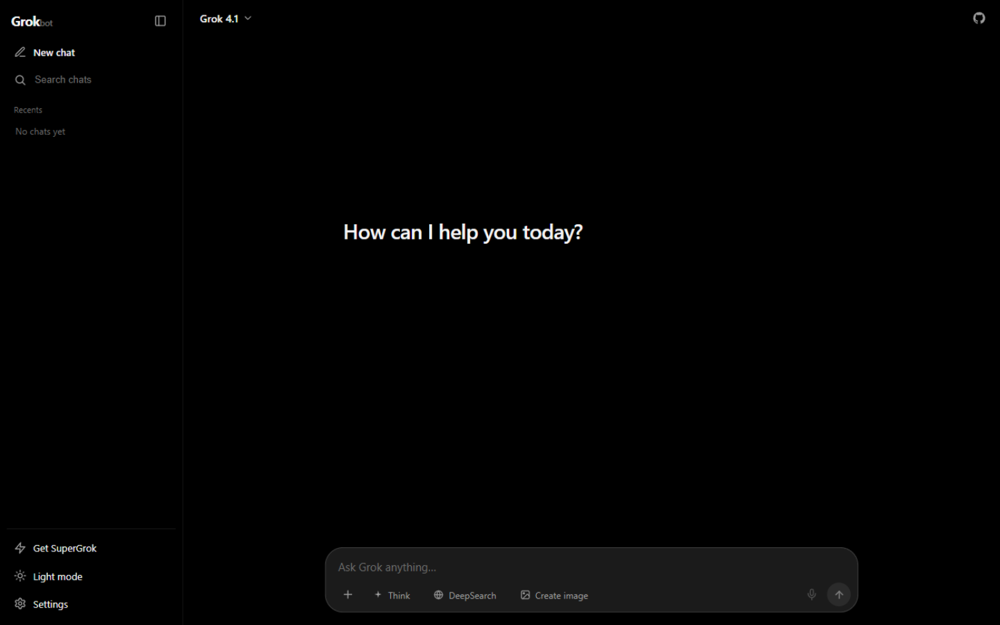

# GrokBot

<p align="center">
  
</p>

**开源 1:1 复刻 Grok（grok.com）网页版。** 流式对话、Think 深度思考、DeepSearch 联网搜索、图像生成、多会话管理、暗色/亮色双主题 —— 约 2000 行代码，Express + 原生 JS，零构建步骤。

**Open-source 1:1 Grok (grok.com) clone.** Streaming chat, Think mode, DeepSearch, image generation, multi-conversation history, dark/light themes — ~2,000 lines of dependency-light code (Express + vanilla JS, zero build step).

> ⚠️ 仅供学习交流的非官方复刻项目，与 xAI 无任何关联。"Grok" 是 xAI 的商标。请使用自己的 API Key，除调用你所配置的 API 端点外，数据不会离开你的机器。
>
> Unofficial fan project for learning purposes. Not affiliated with xAI. "Grok" is a trademark of xAI.

## 截图 / Screenshots

| Dark 暗色 | Light 亮色 |
|---|---|
|  |  |

## 功能 / Features

- 🎨 **1:1 grok.com 界面** — 纯黑暗色主题、胶囊输入框、侧边栏、流式 shimmer 动效 / faithful grok.com UI
- ⚡ **流式输出（SSE）** — 打字机效果，支持停止、重新生成、编辑后重发 / streaming replies with stop · regenerate · edit-and-resubmit
- 🧠 **Think 模式** — 折叠展示"Thought for Xs"推理过程 / collapsible reasoning block
- 🌐 **DeepSearch 联网搜索** — 附带来源引用列表 / web search with a sources list
- 🖼 **Create image 图像生成** — grok-2-image，图片直接渲染在对话里 / inline image generation
- 👁 **视觉理解** — 可附带图片提问 / attach images alongside text
- 📎 文本文件附件自动注入上下文 / text-file attachments as context
- 💬 多会话历史（localStorage），支持搜索 / 重命名 / 删除 / multi-conversation history
- 🌓 暗色 / 亮色主题切换 / dark & light themes
- 📦 Markdown 渲染：代码块（带复制按钮）、表格、引用等 / markdown + code blocks with copy buttons
- 🔑 **BYOK 自带密钥** — 浏览器本地存储或服务端 `.env`，二选一 / bring your own key
- 🔌 **任意 OpenAI 兼容端点** — 改个 Base URL 即可接入中转或其他厂商 / any OpenAI-compatible endpoint

## 快速开始 / Quick start

```bash
git clone https://github.com/kylin-feng/grokbot.git
cd grokbot
npm install
npm start
# 打开 http://localhost:3000
```

到 [console.x.ai](https://console.x.ai) 申请 API Key，然后二选一：

- 在网页 **Settings** 里粘贴（仅存于你的浏览器）/ paste it in the web UI Settings, **or**
- 复制 `.env.example` → `.env`，填入 `XAI_API_KEY`（密钥保留在服务端）/ set it server-side in `.env`

## 配置 / Configuration

| 环境变量 | 默认值 | 说明 |
|---|---|---|
| `XAI_API_KEY` | — | xAI API Key（也可在网页设置里填） |
| `XAI_BASE_URL` | `https://api.x.ai/v1` | 任意 OpenAI 兼容 base URL |
| `PORT` | `3000` | 服务端口 |

网页内设置项：API Key、Base URL、System Prompt、Temperature、模型（grok-4.1 / 4.1-fast / 4 / 4-fast / 3 / 3-mini / 2）。

## 工作原理 / How it works

```
浏览器 ── POST /api/chat (SSE) ──> Express 代理 ──> api.x.ai/v1/chat/completions
                                    （注入密钥、透传流）
```

代理层的作用是让密钥不暴露在页面 JS 里；浏览器填写的 Key（BYOK）优先于服务端 `.env`。会话历史仅保存在浏览器 localStorage。

```
grokbot/
├── server.js              # Express 代理 + 静态托管
├── public/
│   ├── index.html         # 页面结构（grok.com 布局）
│   ├── style.css          # 主题、输入框、消息样式
│   ├── app.js             # 状态、流式、交互逻辑
│   └── markdown.js        # 轻量防 XSS Markdown 渲染器
├── test/mock-upstream.js  # 本地 mock 上游（无 Key 全链路测试）
└── docs/                  # 截图
```

## 无 Key 本地测试 / Test without a key

```bash
node test/mock-upstream.js   # 在 :3999 起一个 OpenAI 兼容 mock
# GrokBot Settings 里 Base URL 填 http://localhost:3999/v1，Key 随便填
```

## 路线图 / Roadmap

- [ ] 语音输入（麦克风按钮占位）/ voice input
- [ ] 会话导出 / 导入 / chat export & import
- [ ] Edit image 模式 / edit-image mode

## 许可 / License

MIT © 2026 GrokBot Contributors
