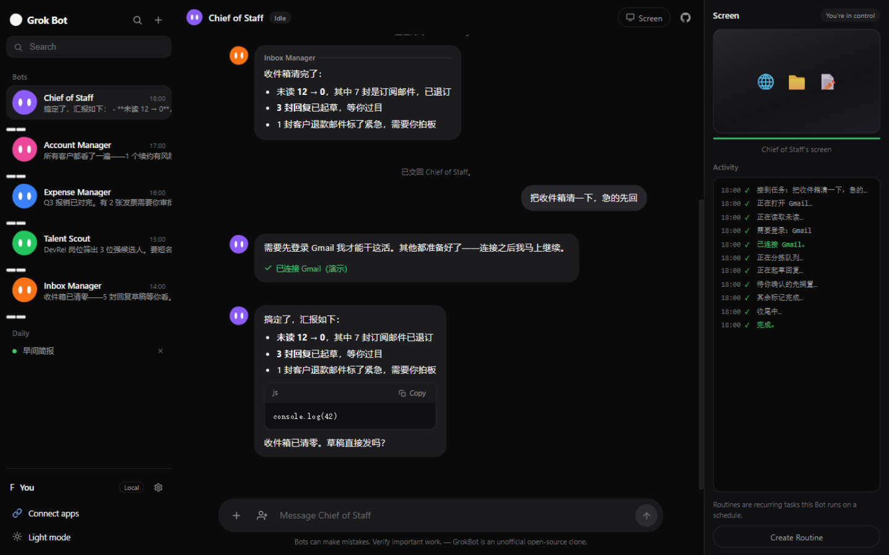
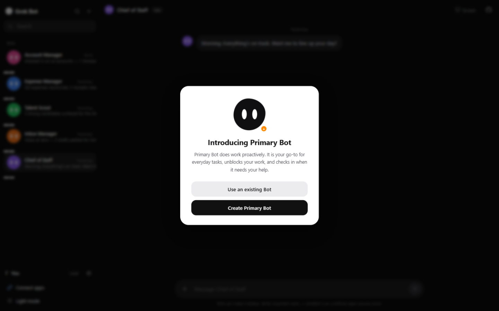
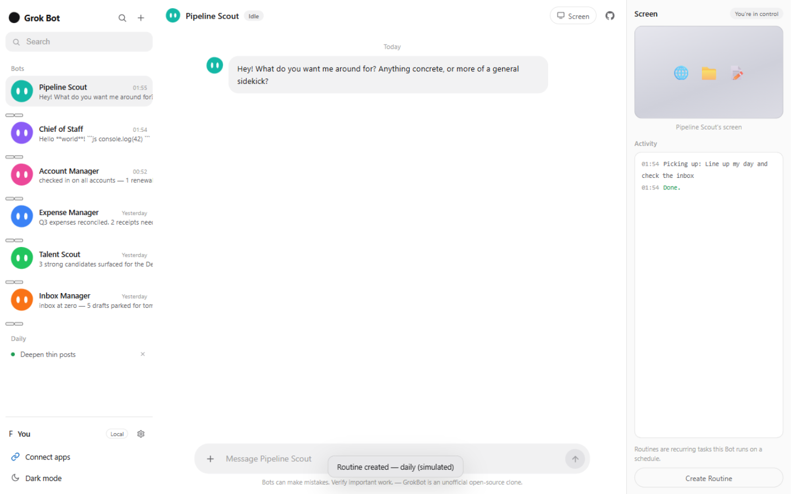

# GrokBot

<p align="center">
  
</p>

**开源复刻 xAI [Grok Bot](https://x.ai/bot) —— 一队"永远在线的 AI 同事"。** 你像给真人同事发消息一样给 Bot 派活；每个 Bot 有自己的角色人设、自己的消息线程，右侧面板实时展示它"云电脑"上的工作活动。Express + 原生 JS，零构建，自带密钥（BYOK）。

**Open-source clone of xAI's Grok Bot** — a team of always-on AI teammates. Message Bots like coworkers, each with its own role and thread; a live "Screen" panel shows what the Bot's computer is up to. Express + vanilla JS, zero build step, bring your own API key.

> ⚠️ 仅供学习交流的非官方复刻项目，与 xAI 无任何关联。"Grok" / "Grok Bot" 是 xAI 的商标。云电脑为本地模拟演示；请使用自己的 API Key。
>
> Unofficial fan project for learning purposes. Not affiliated with xAI. The cloud computer is simulated locally.

## 截图 / Screenshots

| First launch 首次启动 | Light mode 亮色 |
|---|---|
|  |  |

## 它能做什么 / What it does

- 👥 **预置 Bot 团队**：Chief of Staff、Inbox Manager、Talent Scout、Expense Manager、Account Manager —— 每个都是独立角色人设（驱动真实 LLM 的 system prompt），开场就向你汇报
- 🎬 **任务运行时序**（复刻真实产品）：派活后 Bot 走完整生命周期 —— typing 打字点 → 状态变 **Working** → Screen 面板滚任务专属步骤流（带时间戳 + ✓ 对勾 + 进度条 + 迷你浏览器动画）→ 流式汇报卡片 → **Done.** → Idle。同类任务永远跑同样的步骤序列
- 🔐 **中途 check-in**：任务涉及 Gmail / Zendesk / X / Sheets 等应用且未连接时，Bot 会暂停并在聊天里发 "Sign in to …" 卡片，点击连接后自动续跑；连接状态按 Bot 持久化，下次同类任务直通
- 🤝 **Loop in 多 Bot 协作**：聊天框旁的拉人按钮把另一个 Bot 拉进同一线程 —— *"正在询问 Expense Manager…"* 字幕 → 该 Bot 以自己的人设接活汇报（卡片带署名）→ *"已交回 Chief of Staff。"* 交回线程主人
- 🀄 **中文任务全中文运行**：任务语言跟随你——中文派活就是中文步骤流、中文 check-in、中文字幕和汇报；新用户还会预置一段**团队协作示例线程**（派活 → 汇报 → 拉人协作 → 交回）+ 一条例程，打开即知怎么用
- 💬 **同事式消息**：像 iMessage 一样与 Bot 对话，Bot 用要点卡片汇报工作；流式输出、停止、重发、编辑后重新派活
- ✨ **活着的界面**：blob 头像各自节奏眨眼、工作时轻轻浮动；消息入场滑入、发送按钮弹跳、屏幕面板滑入
- 🖥 **Bot 的"云电脑"**：右侧 Screen 面板实时滚动 Bot 的活动日志（Opening browser… / Working the inbox…），状态芯片 Idle ↔ Working ↔ Waiting，"You're in control"
- ➕ **新建 Bot**：起名 + 描述职责即创建，新 Bot 会说 *"Hey! What do you want me around for?"*
- ⏱ **Routines 例行任务**：按 Daily / Every week / Every 2 weeks 分组显示在侧边栏
- 🧩 **首启引导**：复刻官方 "Introducing Primary Bot" 弹窗（Use an existing Bot / Create Primary Bot）
- 🔑 **BYOK**：浏览器本地或服务端 `.env` 存 xAI Key；支持任意 OpenAI 兼容端点（中转可用）
- 🌓 暗色 / 亮色主题；Markdown + 代码块复制；图片 / 文件附件

## 快速开始 / Quick start

```bash
git clone https://github.com/kylin-feng/grokbot.git
cd grokbot
npm install
npm start
# 打开 http://localhost:3000
```

到 [console.x.ai](https://console.x.ai) 申请 API Key，在 **Settings**（侧边栏底部齿轮）里填入即可开聊。也可以复制 `.env.example` → `.env` 设置 `XAI_API_KEY`（密钥保留在服务端）。

## 配置 / Configuration

| 环境变量 | 默认值 | 说明 |
|---|---|---|
| `XAI_API_KEY` | — | xAI API Key（也可在网页设置里填） |
| `XAI_BASE_URL` | `https://api.x.ai/v1` | 任意 OpenAI 兼容 base URL |
| `PORT` | `3000` | 服务端口 |

## 架构 / How it works

```
┌─ Bots sidebar ─┐ ┌──── Chat thread ────┐ ┌─ Bot's "computer" ─┐
│ blob avatars   │ │ teammate messages   │ │ activity log (sim) │
│ routines       │ │ stream via SSE      │ │ Create Routine     │
└────────────────┘ └─────────┬───────────┘ └────────────────────┘
                             │ POST /api/chat
                     Express proxy → api.x.ai/v1/chat/completions
                     (注入密钥、透传 SSE 流)
```

每个 Bot = 一段角色 system prompt + 独立消息历史（localStorage）。云电脑活动为本地模拟（开源复刻无法提供真实云主机），Bot 的回复由真实 LLM 生成。

```
grokbot/
├── server.js              # Express 代理 + 静态托管
├── public/
│   ├── index.html         # 三栏消息应用结构
│   ├── style.css          # 暗色/亮色主题、blob 头像、消息卡片
│   ├── app.js             # Bot 团队、流式对话、Working 模拟、Routine
│   └── markdown.js        # 轻量防 XSS Markdown 渲染器
├── test/mock-upstream.js  # 本地 mock 上游（无 Key 全链路测试）
└── docs/                  # 截图
```

## 无 Key 本地体验 / Try it without a key

```bash
node test/mock-upstream.js   # 在 :3999 起一个 OpenAI 兼容 mock
# Settings 里 Base URL 填 http://localhost:3999/v1，Key 随便填
```

## 与官方 Grok Bot 的差异 / Not included

真实的 Grok Bot 给每个用户提供一台持续运行的云电脑（浏览器、登录态、文件系统），Bot 能真正操作外部软件。本复刻聚焦界面与交互形态：云电脑为模拟日志，Bot 不会真的发邮件或浏览网页 —— 其 system prompt 也明确要求它输出"将要执行的步骤"而不是谎称已完成。

The real Grok Bot gives every user a persistent cloud computer (browser, logins, files) that Bots actually operate. This clone reproduces the UI/UX shape only: the computer is a simulated activity log, and Bot prompts forbid claiming real external actions.

## 路线图 / Roadmap

- [ ] 多 Bot 协作线程（"Looping in Comms…" 式交接）
- [ ] Teach a task（录一次操作 → Routine）
- [ ] Connect apps 占位接真实 OAuth（需自行接入）

## 许可 / License

MIT © 2026 GrokBot Contributors
